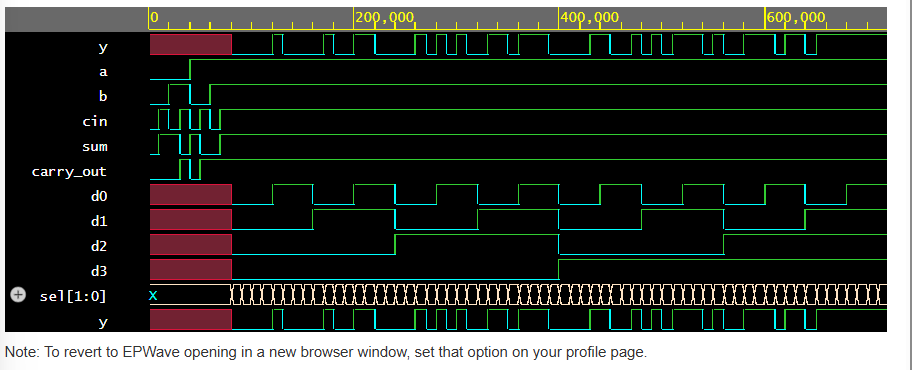

# Structural & Behavioral Combinational Logic Engine

## Week 1 HDL Project

This project implements and verifies two combinational digital circuits using Verilog HDL:
- 1-bit Full Adder
- 4:1 Multiplexer (MUX)

## Objectives

- Implement combinational logic using Verilog.
- Understand dataflow and behavioral modeling.
- Verify circuit functionality using a testbench.
- Inspect simulation waveforms.

## 1. Full Adder

The Full Adder adds three 1-bit inputs: `a`, `b`, and `cin`.

Outputs:
- `sum`: Sum bit
- `carry_out`: Carry bit

Logic equations:

- `sum = a XOR b XOR cin`
- `carry_out = (a AND b) OR (b AND cin) OR (a AND cin)`

Implementation: Continuous assignments using `assign`.

## 2. 4:1 Multiplexer

The MUX selects one of four data inputs (`d0`, `d1`, `d2`, `d3`) according to the 2-bit select signal `sel`.

| sel | Output |
|---|---|
| 00 | d0 |
| 01 | d1 |
| 10 | d2 |
| 11 | d3 |

Implementation: Behavioral modeling using `always @(*)` and `case`.

## 3. Testbench and Verification

The testbench checks:
- All 8 input combinations of the Full Adder.
- All 64 combinations of the MUX data inputs and select lines.
- Output mismatches using automatic checks.
- Simulation waveform generation in VCD format.

Expected successful result:

`PASS: All 8 Full Adder and 64 MUX tests passed.`

## 4. Files

- `full_adder.v` — Full Adder design.
- `mux4to1.v` — 4:1 MUX design.
- `tb_combinational.v` — Simulation testbench.

## 5. Run the Simulation

Open the project on EDA Playground:

https://edaplayground.com/x/TcLi

Select a compatible Verilog simulator, such as Icarus Verilog, and run the testbench. View the waveform in EPWave.

## 6. What I Learned

- Combinational logic design in Verilog HDL.
- Dataflow and behavioral modeling.
- Testbench stimulus and automated output checking.
- Simulation logs and waveform analysis.

## Waveform Verification

